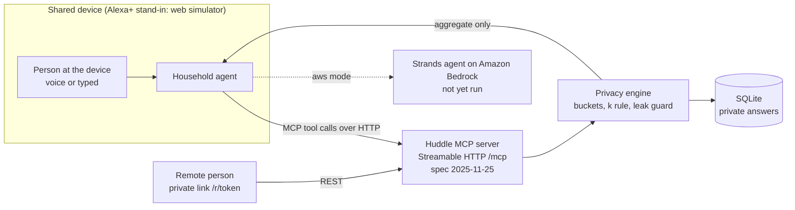

# Huddle

**A private group-decision agent.** Everyone answers in private. Huddle works out what fits all the limits and proposes one plan, with the trade-off explained, without saying who set which limit.

Built for the [Amazon Developer Hackathon](https://amazonappdev2026.devpost.com/) (primary track: Alexa+; mini-challenges: AWS Builder, Open Source). A new project, started after Aug 31, 2026.

## The problem

Some group decisions depend on numbers people don't want to say out loud: how much money they can spend, how many hours they can give, what they simply can't do. When one person has to speak first, that person's limit becomes the group's limit, and the rest either stay quiet or resent it. The decision stalls, or gets made around whoever was most open.

The clearest case is **siblings sharing the care of an ageing parent**. Context, from [AARP and the National Alliance for Caregiving, *Caregiving in the U.S. 2025*](https://www.aarp.org/press/releases/2025-07-24-new-report-reveals-crisis-point-for-americas-63-million-family-caregivers.html):

- 63 million Americans (nearly 1 in 4 adults) provided ongoing care for an adult or a child in the past year.
- Caregivers pay roughly $7,200 a year out of pocket on average.
- Nearly 1 in 4 caregivers provide 40 or more hours of care a week, and nearly half had at least one major financial impact.

Those figures are sourced facts about caregiving. **Our claim that families stall because nobody wants to say their limits aloud, and that Huddle eases it, is a hypothesis we have not yet tested with real families** (see [docs/user-test.md](docs/user-test.md), not yet run). The same shape shows up in smaller decisions: picking a weekend plan, or a friends' trip where nobody wants to be the one with the smallest budget.

## What Huddle does

1. **Asks each person privately**, the way that suits them: by voice at a shared device, or through a private one-time link on their own phone.
2. **Computes what is compatible** from everyone's limits, and only reports group-level results in coarse bands, never attributed to a person.
3. **Proposes one plan and explains the trade-off** ("Picked X; some of you preferred Y, but the budget ruled it out") without naming anyone.
4. **Handles people who don't answer**: a reminder, then a stated default, so the group isn't stuck.
5. **Checks in the day after**: each person privately rates how the plan sits with them; the group sees only an unattributed summary.

| Mode | Each person privately gives | Output |
|---|---|---|
| **Care** (main story) | hours/week, dollars/month, task types they can't do | the care need vs. what's covered (gap in bands), a task split that respects every limit, ways to close the gap |
| **Weekend plan** | budget, vibe, dealbreakers | one activity and the trade-off |
| **Friends' trip** | budget for the trip, vibe, dealbreakers | one trip and the trade-off |

**What it is not:** it decides; it doesn't plan itineraries, book anything, split expenses, read calendars, or give medical, legal or financial advice. Care mode collects no health data. Tools like CareSplit track tasks and costs *after* a split is agreed; Huddle helps reach the split first (see [docs/novelty-search.md](docs/novelty-search.md)).

## How it works



- `server/mcp_server.py`: self-hosted MCP server, Streamable HTTP at `/mcp`. Tools: `start_huddle`, `submit_private_answer`, `get_group_result`, `close_round`, `nudge_pending`, `submit_checkin`. Uses the official `mcp` SDK (pinned `<2`).
- The simulator (`web/`, Vite + React) stands in for Alexa+. Its agent calls the MCP server over HTTP at runtime (`/api/agent/tool` proxies to `/mcp`).
- `server/engine/`: `privacy.py` (bands, k rule, leak guard), `rounds.py` (lifecycle, check-in, audit trail), `everyday.py`, `trip.py`, `care.py` (integer task split with `scipy.optimize.milp`).
- Private answers are stored server-side and returned only to their owner (`GET /me/answers`). The audit trail records who did what and when, never what anyone answered.
- Voice: browser Web Speech for transcription, optional local Whisper fallback, and optional SpeechBrain ECAPA speaker ID as a stand-in for Alexa person recognition.

## Quickstart (mock mode, no AWS credentials)

```
make install
make dev      # API + MCP on :8000, simulator on http://localhost:5173
make test     # includes the privacy leak test
make e2e      # Playwright (needs Google Chrome): demo flows, failure path, accessibility audit
make docker   # or: docker compose up --build  -> http://localhost:8000
```

Optional extras: `pip install '.[voice]'` (speaker ID and Whisper), `pip install '.[aws]'` (Strands and Bedrock).

## Honest limits

- **Privacy is no-attribution plus bucketing, not cryptographic secrecy.** With **two people**, the other person can infer your number from a band; the UI says so. With three or more, who set a limit is hidden. Research systems that give real cryptographic guarantees exist (see the novelty notes); Huddle doesn't claim that.
- Care mode shows assignments, not capacities, but an assignment can hint at what someone can do.
- **Voice identification is a stand-in for Alexa person recognition.** It separates profiles on a shared device and is not security. Accuracy has only been measured on synthetic text-to-speech voices ([docs/voice-accuracy.md](docs/voice-accuracy.md)): that shows the pipeline works, not how it behaves for real family voices.
- **The Alexa+ experience is simulated.** The Alexa+ developer tools are preview and select-partner only; the simulator and the MCP server are both in this repo.
- Reminders are simulated: the round's state changes when the reminder time passes, and nothing is actually sent.

## Status (what is verified, what is not)

| Area | State |
|---|---|
| MCP server, privacy engine, three modes, check-in, audit trail | Built; 60 automated tests including the leak test |
| Simulator and private link flow | Built; 8 browser tests (demo flows, failure path, phone width, accessibility in light and dark, microphone path) |
| Voice ID and Whisper | Built; measured on synthetic voices only |
| Strands agent on Bedrock, AgentCore hosting | Code and notes written, **never run against AWS** |
| Real-group user test | **Not run** |

Full plan: [docs/development-plan.md](docs/development-plan.md). Friction log: [docs/friction-log.md](docs/friction-log.md). Product feedback: [docs/product-feedback.md](docs/product-feedback.md).

## Licence

MIT. Third-party components: [THIRD_PARTY.md](THIRD_PARTY.md).
