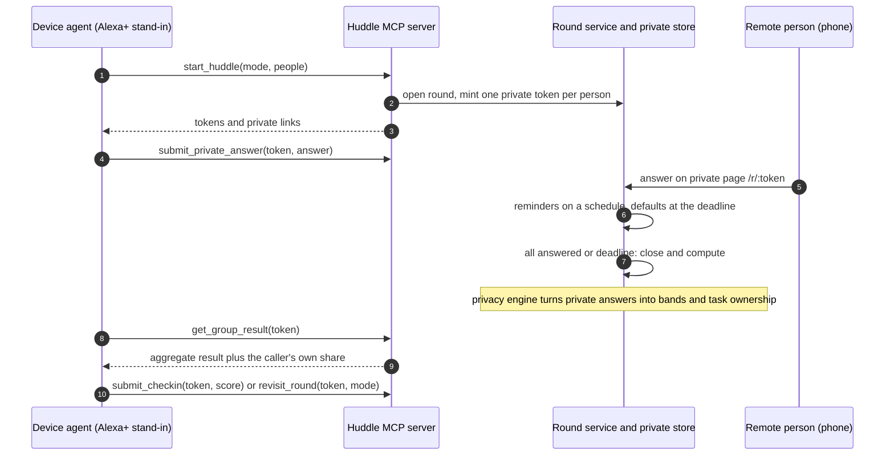
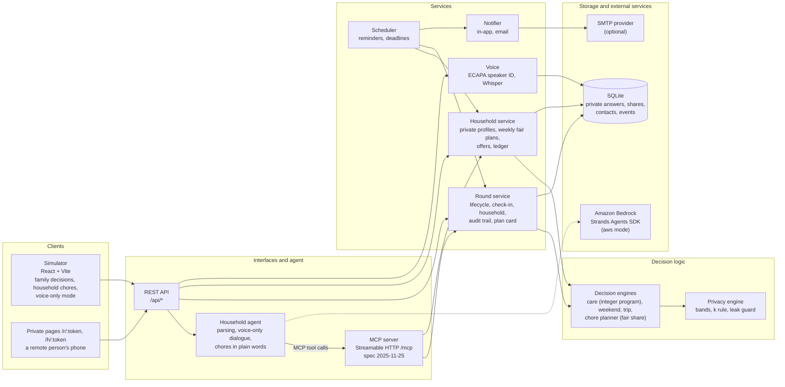
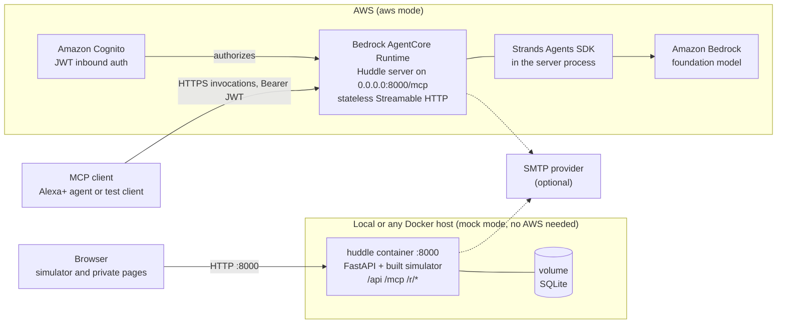

# Huddle

**A private group-decision agent for the household.** Everyone answers in private. Huddle works out what fits all the limits and proposes one plan, with the trade-off explained, without saying who set which limit.

Built for the [Amazon Developer Hackathon](https://amazonappdev2026.devpost.com/): primary track **Alexa+**, mini-challenges **AWS Builder** and **Open Source**. A new project, started after Aug 31, 2026, released under the MIT licence.

---

## The problem

Some decisions depend on numbers people don't want to say out loud: what they can spend, how many hours they can give, what they simply can't do. When one person has to speak first, that person's limit becomes the group's limit, and everyone else stays quiet or resents it.

The clearest case is **siblings sharing the care of an ageing parent**. From [AARP and the National Alliance for Caregiving, *Caregiving in the U.S. 2025*](https://www.aarp.org/press/releases/2025-07-24-new-report-reveals-crisis-point-for-americas-63-million-family-caregivers.html):

- 63 million Americans (nearly 1 in 4 adults) provided ongoing care for an adult or a child in the past year.
- Caregivers pay roughly $7,200 a year out of pocket on average.
- Nearly 1 in 4 caregivers provide 40 or more hours of care a week, and nearly half had at least one major financial impact.

The same shape shows up every day in **household chores**, where one person often ends up carrying most of the load, including the invisible part: noticing what needs doing, planning it and remembering it. Sources (details and what each does and doesn't show in [docs/evidence-household-load.md](docs/evidence-household-load.md)):

- On an average day in the U.S., women spent 2.8 hours on household activities and men 2.1 hours, among those who did any ([BLS, American Time Use Survey 2025](https://www.bls.gov/news.release/atus.htm)).
- In a survey of married and cohabiting adults, 59% of women said they do more of the household chores than their partner, and 38% of women were very satisfied with how chores are divided in October 2020, against 55% of men ([Pew Research Center, 2021](https://www.pewresearch.org/short-reads/2021/01/25/for-american-couples-gender-gaps-in-sharing-household-responsibilities-persist-amid-pandemic/)).
- In interviews with 35 couples, one partner did more of the anticipating and monitoring behind household tasks even when couples described the split as shared ([Daminger, *American Sociological Review*, 2019](https://behavioralscientist.org/how-couples-share-cognitive-labor-and-why-it-matters/)).
- Across 14 studies, in 11 women reported more depressive or psychological distress as their unpaid labour demands rose (Ervin et al., *The Lancet Public Health*, 2022).

The same shape shows up in smaller decisions too: a weekend plan, or a friends' trip where nobody wants to be the one with the smallest budget.

## What Huddle does

Huddle is built for a **household**, in two connected parts, handled one way: *private limits in, one unattributed plan out.*

- **Family decisions** (a care split, a weekend, a trip): a group decides once, with everyone's limits kept private.
- **Household chores**: a fair agent splits the week's chores among the people who live there, week after week, from everyone's private availability, preferences and skills.

### Family decisions

1. **Asks each person privately**, in the way that suits them: by voice at a shared device, or on their own phone through a private one-time link.
2. **Works out what is compatible** and reports only group-level results, in coarse bands.
3. **Proposes one plan and explains the trade-off**, without naming anyone ("Picked X; some of you preferred Y, but the budget ruled it out").
4. **Reminds people who haven't answered**: a first reminder half-way and a final one near the deadline, plus a host nudge. In-app, optional email, and the device's share sheet. Then a stated default if someone still doesn't answer.
5. **Lets people change their mind** until the round closes.
6. **Checks in the day after**: each person privately rates how the plan sits with them, and the group sees an unattributed summary.
7. **Plans the next decision for the same family**, without retyping who's in it. It can be the same decision again or a different one. The care plan shapes what follows: whoever carries heavy care tasks gets an optional private hint when leisure plans are made, and a fair-share record rotates heavy tasks across care rounds.
8. **Hands over a plan card**: a copyable, printable summary that the assistant can also read aloud.

| Decision | Each person privately gives | The group gets |
|---|---|---|
| **Share care for a parent** (flagship) | hours/week, dollars/month, task types they can't do | the care need vs. what's covered (gap in bands), who owns which task, ways to close the gap. Each person sees their own hours privately. |
| **Plan a weekend** | budget, vibe, dealbreakers | one activity and the trade-off |
| **Plan a trip** | budget for the trip, vibe, dealbreakers | one trip and the trade-off |

Huddle decides; it doesn't book anything, split expenses, read calendars, or give medical, legal or financial advice. Care mode collects no health data.

### Household chores: the fair agent
Housework isn't one decision, it's a stream, and it's easy for it to pile up on one person. Each member tells the agent **privately** how many hours they can take, what they love, avoid or can't do, what they're good at, and what they'd like to learn. Chores can be **added any time in plain words** ("clean the gutters by Saturday, about an hour") or **pre-planned** with a due date or a recurrence. Then:

- **The agent plans each week fairly:** hard limits first (nobody gets what they can't do or more than they offered), then a fair share in proportion to each person's own availability, with heavier chores and mental load (planning, booking, remembering) weighted up, then preferences and skills, then rotation of heavy chores.
- **It remembers:** a rolling ledger of what people actually did lightens the load of someone who carried extra, and a heavy week (reported privately) lightens the next. Exemptions are capped and availability has a floor, so private self-reports can't be used to dodge a fair share.
- **It negotiates ad hoc chores:** a new chore is *offered* to the best-fit person, who can accept or decline; if they decline, or don't answer for 24 hours, the agent asks the next. Nobody can see who was asked or who declined.
- **It talks plainly:** "what's on my plate", "I did the bins", "who has the laundry", "hand back the laundry", by typing or speaking, or through the MCP tools.
- **It's transparent without exposing anyone:** the household sees who owns what and an aggregate fairness report; each person sees their own load against their own fair share. How it decides, and what is and isn't visible, is in [docs/fairness-agent.md](docs/fairness-agent.md).

### On a shared speaker
Answering a private number out loud can be overheard, so the **voice-only mode** (see [docs/alexa-fit.md](docs/alexa-fit.md)) starts by asking whether anyone is within earshot and offers the person's private phone link or the screen instead. The assistant never says an answer back unless asked, the draft stays on the server, it is saved through the MCP tool, and consent is spoken.

## Privacy model

- Private answers are stored server-side and returned only to their owner.
- The group sees aggregates in coarse bands, and who owns each task, never anyone's hours or limits, and never who set a limit. Each person's own hours are returned only for their own token.
- In the household, each member's availability, preferences, skills, exemptions, decline reasons and how a week felt are returned only to them. The group sees chores, who owns them, and an aggregate fairness report; the audit trail never says who was asked or why.
- Matching is private, not cryptographic: with three or more people, who set a limit stays hidden; with two people, the other person can work out your number, and the app says so.
- Voice identification is a stand-in for Alexa person recognition. It separates profiles on a shared device; it does not authenticate anyone.
- An automated **leak test** seeds distinctive values and calls every route and MCP tool as every participant, failing if anyone else's value appears.

## How a round works



## Technical architecture



| Layer | Where | What it does |
|---|---|---|
| MCP server | `server/mcp_server.py` | Seventeen tools over Streamable HTTP (seven for family decisions, ten for the household), called at runtime by the household agent |
| Privacy engine | `server/engine/privacy.py` | Bands, the k rule, the leak guard |
| Round service | `server/engine/rounds.py` | Lifecycle, answers, revision, check-in, household chain, reminders, audit trail |
| Decision engines | `server/engine/care.py`, `everyday.py`, `trip.py` | Care split via `scipy.optimize.milp`; weekend and trip matching |
| Chore planner | `server/engine/chores.py` | Fair weekly split of household chores (integer program): hard limits, fair share by private availability, ledger, preferences, rotation |
| Household service | `server/engine/home.py` | Persistent households, private profiles, ad hoc and pre-planned chores, offers (ask, accept, decline, re-ask), ledger, reminders, weekly auto-plan |
| Household agent | `server/agent/` | Mock parser by default; Strands agent on Bedrock in `aws` mode; the voice-only dialogue; chores understood from plain words |
| Voice | `server/voice/` | SpeechBrain ECAPA speaker identification and local Whisper transcription |
| Notifier | `server/notify.py` | In-app and email reminders |
| Simulator | `web/` | The Alexa+ stand-in and the private link pages |

## Deployment architecture

The same container image runs locally and on AWS. It serves the simulator, the REST API and the MCP endpoint on one port.



- **Local:** `make docker` (or `docker compose up --build`) builds `deploy/Dockerfile` and serves everything on `http://localhost:8000`. No AWS credentials are needed.
- **AWS:** the same server image listens on `0.0.0.0:8000/mcp`, the contract AgentCore Runtime expects of an MCP server. Steps are in [deploy/agentcore/README.md](deploy/agentcore/README.md). `HUDDLE_MODE=aws` switches the agent to Strands on Amazon Bedrock.
- **CI:** GitHub Actions runs lint and unit tests, the Playwright browser tests, and a Docker build that starts the container and checks it serves the app.

## MCP server

Streamable HTTP at `/mcp`, protocol version 2025-11-25 (official `mcp` Python SDK). Every tool takes the caller's own signed token; none returns another person's raw answer or private limits.

**Family decisions**

| Tool | Purpose |
|---|---|
| `start_huddle` | Open a round (`care`, `everyday` or `trip`) for 2 to 6 people; returns a private token and link per person |
| `submit_private_answer` | Store or revise one person's validated answer; consent required |
| `get_group_result` | The aggregate result once the round closes, plus the caller's own share |
| `close_round` | Host only: close now; non-responders get stated defaults |
| `nudge_pending` | Host only: remind everyone who hasn't answered; per-channel delivery results |
| `submit_checkin` | The day-after private 1 to 5 check-in |
| `revisit_round` | Host only: the household's next round, same decision or a different one |

**Household chores**

| Tool | Purpose |
|---|---|
| `create_household` | 2 to 6 people (optional email for reminders); returns a private token per member |
| `get_household` | This week's shared plan and fairness report, plus only the caller's own private profile, offers and load |
| `set_my_profile` | Private: availability, preferences, skills, things to learn, keywords, and a capped weekly exemption |
| `add_chore` | Add a chore any time, from fields or plain words; if the week is planned the best-fit person is asked |
| `plan_week` | Plan a week fairly from everyone's private limits (redoing an existing plan is admin only) |
| `respond_to_assignment` | Accept or decline an offer made to the caller; a decline makes the agent ask someone else |
| `hand_back_chore` | The owner can't do it after all: the agent asks the next best person |
| `complete_chore` | The owner marks a planned chore done |
| `week_checkin` | Private: how the week felt; a heavy week lightens the next |
| `ask_household_agent` | Plain words: add a chore, "what's on my plate", "I did the bins", "who has the laundry" |

Try it from any MCP client:

```python
import asyncio
from mcp import ClientSession
from mcp.client.streamable_http import streamable_http_client

async def main():
    async with streamable_http_client("http://localhost:8000/mcp") as (read, write, _):
        async with ClientSession(read, write) as session:
            init = await session.initialize()
            print(init.protocolVersion)                # 2025-11-25
            print([t.name for t in (await session.list_tools()).tools])

asyncio.run(main())
```

## Quickstart

Mock mode needs no AWS credentials.

```
make install   # Python 3.12 venv and web dependencies
make dev       # API and MCP on :8000, simulator on http://localhost:5173
```

Open `http://localhost:5173`. For the household, open the **Household chores** tab, create a household, press **Add a starter set of chores** then **Plan the week**, switch between members to set private limits, and try the agent ("add fix the squeaky door"). For family decisions, stay on **Family decisions**, keep "Share care for a parent" selected and press **Start the huddle**. Answer as Maya and Ben on the device (type or speak your answer, or turn on voice-only mode), open Chen's private link in a second tab, and watch the plan appear. Use the short 45-second deadline option to see the reminder and the stated defaults.

```
make test      # unit, protocol and leak tests
make e2e       # Playwright browser tests (needs Google Chrome)
make docker    # or: docker compose up --build  ->  http://localhost:8000
make lint
```

Optional extras: `pip install '.[voice]'` (speaker ID and Whisper), `pip install '.[aws]'` (Strands and Bedrock).

### Configuration

| Setting | Default | Meaning |
|---|---|---|
| `HUDDLE_MODE` | `mock` | `mock` runs without AWS; `aws` runs the agent on Amazon Bedrock |
| `HUDDLE_DB_URL` | `sqlite:///huddle.db` | Database |
| `HUDDLE_SECRET` | dev value | Signs round tokens; set it in any shared deployment |
| `HUDDLE_PUBLIC_URL` | `http://localhost:8000` | Address used for links in reminder emails |
| `HUDDLE_TICK_SECONDS` | `15` | Scheduler interval for reminders and deadlines |
| `HUDDLE_SMTP_HOST`, `_PORT`, `_USER`, `_PASSWORD`, `_FROM`, `_STARTTLS` | unset | Turns on email reminders |
| `HUDDLE_BEDROCK_MODEL_ID`, `AWS_REGION` | unset | Bedrock model and region for `aws` mode |

## Repository layout

```
server/            FastAPI app, MCP server, engines, agent, voice, notifier
  engine/          privacy, rounds, care, everyday, trip, plan card, chores (fair planner), home (household service)
  agent/           answer parsing, voice-only dialogue, chore understanding, prompts, Strands agent
  voice/           speaker identification, transcription
web/               React + Vite simulator and private link pages; Playwright tests
deploy/            Dockerfile, AgentCore hosting notes
tests/             unit, protocol, leak and voice tests; synthetic audio fixtures
scripts/           helpers (audio fixtures, scripted rounds)
docs/              plan, architecture notes, accuracy reports, friction log, product feedback
```

## Verification

- 209 automated tests, including the privacy leak test across every REST route and MCP tool (with a full household lifecycle of profiles, plans, offers, declines and check-ins), a protocol test asserting the negotiated MCP version, the fairness engine's hard-limit, fairness, preference, rotation and ledger properties, the chore agent's parsing and intents, the scheduler, real SMTP delivery against a local mail sink, and an end-to-end run of a fictional family through speaker ID, Whisper, the voice-only dialogue and the MCP tools ([docs/family-simulation.md](docs/family-simulation.md)).
- 26 Playwright browser tests covering the flows, the household, reminders, voice-only privacy, phone width, and accessibility (axe, WCAG A and AA) in light and dark.
- Voice accuracy report: [docs/voice-accuracy.md](docs/voice-accuracy.md).

## Documentation

- [docs/alexa-fit.md](docs/alexa-fit.md): why a shared voice assistant, and how the voice-only mode handles privacy
- [docs/fairness-agent.md](docs/fairness-agent.md): how the household agent defines and keeps fairness, and what is private
- [docs/evidence-household-load.md](docs/evidence-household-load.md): sourced evidence on unequal household load
- [docs/novelty-search.md](docs/novelty-search.md): related work and how Huddle differs
- [docs/friction-log.md](docs/friction-log.md) and [docs/product-feedback.md](docs/product-feedback.md): developer-experience notes for the tools used
- [docs/development-plan.md](docs/development-plan.md): the build plan
- [THIRD_PARTY.md](THIRD_PARTY.md): libraries, models and licences

## Hackathon

- **Track:** Alexa+. A self-hosted MCP server (Streamable HTTP, 2025-11-25) that an Alexa+ agent calls, with a web simulator as the Alexa+ experience; both are in this repository.
- **AWS Builder:** Amazon Bedrock through the Strands Agents SDK, with hosting on Bedrock AgentCore Runtime (see [deploy/agentcore/README.md](deploy/agentcore/README.md)).
- **Open Source:** this repository, MIT licensed, created after Aug 31, 2026.

## Licence

MIT. See [LICENSE](LICENSE).
